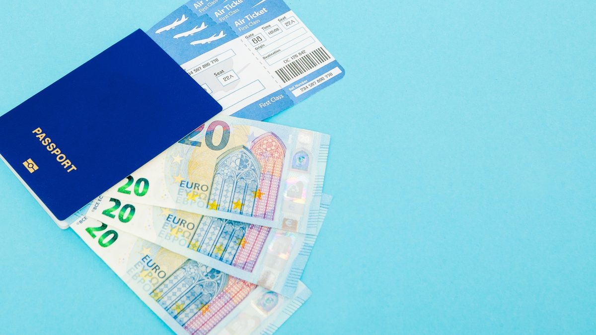

```liczby
49 EUR | dieta za dobę w Niemczech
170 EUR | limit hotelu za noc w Niemczech
14 dni | na rozliczenie po powrocie
25% | limitu hotelu – ryczałt, gdy nie ma rachunku
```

## Czym delegacja zagraniczna różni się od oddelegowania?

Potocznie oba wyjazdy nazywa się „delegacją”, ale prawo traktuje je zupełnie inaczej:

| Delegacja (podróż służbowa) | Oddelegowanie do pracy |
| --- | --- |
| konkretne zadanie, potem powrót | praca u klienta lub w oddziale za granicą |
| zwykle kilka dni lub tygodni | często miesiące |
| diety, hotel i ryczałty z rozporządzenia | warunki państwa przyjmującego, np. tamtejsza płaca minimalna |
| polecenie wyjazdu, zaliczka, A1 | A1, zgłoszenie pracownika za granicą |

Ten poradnik dotyczy **podróży służbowej** – czyli wyjazdu na spotkanie, targi, szkolenie, montaż czy audyt, po którym wracasz do zwykłego miejsca pracy. Jeśli firma wysyła cię na dłużej do pracy dla zagranicznego klienta, mogą obowiązywać przepisy o delegowaniu pracowników w ramach świadczenia usług (dyrektywa 96/71/WE).

## Czy można odmówić wyjazdu w delegację?

Co do zasady nie. Delegacja to polecenie służbowe, a pracownik ma obowiązek wykonywać polecenia dotyczące pracy, jeśli nie są sprzeczne z prawem ani umową (art. 100 Kodeksu pracy). Nieuzasadniona odmowa może być naruszeniem obowiązków pracowniczych.

Są jednak wyjątki. **Bez zgody pracownika nie można wysłać w podróż służbową** (art. 178 Kodeksu pracy):

- pracownicy w ciąży,
- pracownika wychowującego dziecko do ukończenia **8. roku życia** – z tego uprawnienia może korzystać tylko jeden z rodziców.

Wysłanie takiej osoby w delegację bez zgody jest wykroczeniem przeciwko prawom pracownika – grozi za nie grzywna od 1000 do 30 000 zł (art. 281 Kodeksu pracy). Jeśli wyjazd za granicę ma trwać **ponad 4 kolejne tygodnie**, pracodawca musi przed wyjazdem poinformować na piśmie m.in. o państwie, czasie pracy za granicą, walucie wynagrodzenia i warunkach powrotu (art. 29¹ Kodeksu pracy).

## Co załatwić przed wyjazdem za granicę?

Lista rzeczy, które warto mieć gotowe przed delegacją:

1. **Polecenie wyjazdu służbowego** – cel, miejsce, termin, środek transportu. To pracodawca decyduje, czym jedziesz i jaką klasą (§ 3 rozporządzenia). Na samochód prywatny potrzebna jest jego zgoda na twój wniosek.
2. **Zaliczka** – pracodawca wypłaca ją w walucie obcej, w wysokości wstępnej kalkulacji kosztów. Za twoją zgodą może ją wypłacić w złotych po średnim kursie NBP z dnia wypłaty (§ 20).
3. **Zaświadczenie A1** – przy wyjeździe do innego państwa UE, EFTA, Szwajcarii lub Wielkiej Brytanii potwierdza, że dalej podlegasz polskiemu ZUS. Wniosek składa pracodawca przez PUE eZUS. Przepisy nie przewidują wyjątku dla krótkich wyjazdów, a część państw sprawdza A1 przy kontrolach.
4. **Leczenie za granicą** – w UE weź kartę EKUZ. Pracodawca zwraca udokumentowane, niezbędne koszty leczenia, z wyjątkiem świadczeń pokrywanych w ramach koordynacji w UE (§ 19), dlatego wiele firm wykupuje też polisę podróżną.
5. **Wiza, rezerwacje, kto płaci hotel** – warto ustalić z góry, czy hotel opłaca firma (wtedy nie przysługuje ani zwrot, ani ryczałt za nocleg).

## Od kiedy liczy się czas delegacji zagranicznej?

To najczęstsze źródło błędów, bo dieta zależy od liczby godzin. Według § 12 rozporządzenia czas podróży zagranicznej liczy się:

| Transport | Czas za granicą liczy się |
| --- | --- |
| samochód, pociąg, autobus | od przekroczenia granicy do powrotnego przekroczenia granicy |
| samolot | od startu z ostatniego lotniska w Polsce do lądowania na pierwszym lotnisku w Polsce |
| statek, prom | od wyjścia z ostatniego portu w Polsce do wejścia do pierwszego portu w Polsce |

Czas od wyjazdu z miejscowości do granicy (albo do startu samolotu) i od powrotu do kraju do domu to **część krajowa** – rozlicza się ją według zasad delegacji krajowej, z dietą 45 zł (§ 21).

Dieta zagraniczna za każdą pełną dobę przysługuje w całości, a za niepełną dobę: do 8 godzin – 1/3 diety, ponad 8 do 12 godzin – 50%, ponad 12 godzin – cała dieta (§ 13). Szczegóły i stawki dla wszystkich państw znajdziesz przy [kalkulatorze diety zagranicznej](/praca/dieta-zagraniczna/).

## Co przysługuje w delegacji zagranicznej?

| Należność | Ile wynosi |
| --- | --- |
| Dieta | stawka państwa docelowego za dobę (§ 13) |
| Zapewnione posiłki | minus 15% diety za śniadanie, 30% za obiad i 30% za kolację (§ 14) |
| Hotel z rachunkiem | zwrot do limitu państwa, więcej tylko za zgodą pracodawcy (§ 16) |
| Nocleg bez rachunku | ryczałt 25% limitu za noc, ale nie za noc w podróży (§ 16) |
| Dojazd z i do dworca lub lotniska | ryczałt 1 dieta, a w jedną stronę 50% (§ 17) |
| Komunikacja miejska | ryczałt 10% diety za każdą rozpoczętą dobę (§ 17) |
| Bilety i inne wydatki | zwrot według rachunków: bagaż, autostrady, parkingi (§ 3–4) |
| Leczenie za granicą | zwrot udokumentowanych, niezbędnych kosztów (§ 19) |

Ryczałtów na dojazdy i komunikację miejską **nie ma**, gdy jedziesz samochodem (służbowym albo prywatnym), masz zapewnione bezpłatne dojazdy albo nie ponosisz tych kosztów. Przy samochodzie prywatnym dostajesz za to kilometrówkę według stawki ustalonej przez pracodawcę – nie wyższej niż limit z przepisów.

Ile to w złotych? Diety i limity hoteli w najczęściej wybieranych kierunkach – po średnim kursie NBP z 26 listopada 2026 r.:

```wykres
typ: slupki
tytul: Dieta za dobę w delegacji zagranicznej (w zł)
jednostka: zł
zrodlo: Załącznik do rozporządzenia o podróżach służbowych (stawki od 29.11.2022), kursy NBP z tabeli 230/A/NBP/2026
Szwajcaria (88 CHF) | 431
Dania (446 DKK) | 267
Austria (57 EUR) | 255
Francja (55 EUR) | 246
Wielka Brytania (45 GBP) | 241
USA (59 USD) | 241
Włochy (53 EUR) | 237
Hiszpania (50 EUR) | 224
Niemcy (49 EUR) | 220
Czechy (41 EUR) | 184
```

```wykres
typ: slupki
tytul: Limit hotelu za noc (w zł)
jednostka: zł
zrodlo: Załącznik do rozporządzenia o podróżach służbowych, kursy NBP z tabeli 230/A/NBP/2026
Wielka Brytania (220 GBP) | 1178
Szwajcaria (220 CHF) | 1078
Francja (200 EUR) | 896
Hiszpania (200 EUR) | 896
Włochy (192 EUR) | 860
USA (200 USD) | 817
Niemcy (170 EUR) | 762
Austria (150 EUR) | 672
Czechy (120 EUR) | 538
```

Sprawdź szybko, ile należy się za twój wyjazd:

```widzet
nazwa: delegacja-zagraniczna
kraj: niemcy
doby: 2
godziny: 13
sniadania: 2
obiady: 2
```

## Jak rozliczyć delegację zagraniczną – przykład krok po kroku?

> **Przykład.** Pracownica z Krakowa leci na 3-dniową konferencję do Frankfurtu. Wyjazd z domu w poniedziałek o 5:00, start samolotu z Krakowa o 7:00, powrót – lądowanie w Krakowie w środę o 20:30, w domu o 21:30. Hotel kosztował 190 EUR za noc (2 noce), śniadania były w cenie hotelu, a obiady zapewnili organizatorzy konferencji. Zaliczka: 500 EUR.

**Krok 1. Czas podróży.** Od startu samolotu (pn 7:00) do lądowania (śr 20:30) mija 61,5 godziny – 2 pełne doby i 13,5 godziny. Ponad 12 godzin to pełna dieta, więc przysługują **3 diety**.

**Krok 2. Dieta i posiłki.** 3 × 49 EUR = 147 EUR. Za 2 śniadania odejmujemy 2 × 15% diety, a za 2 obiady 2 × 30% – razem 44,10 EUR.

**Krok 3. Hotel.** Rachunek 380 EUR, ale limit w Niemczech to 170 EUR za noc. Zwrot: **340 EUR**. Nadwyżkę 40 EUR firma zwróci tylko, jeśli się na to zgodzi.

**Krok 4. Ryczałty.** Dojazd z i do lotniska we Frankfurcie: 1 dieta, czyli 49 EUR. Komunikacja miejska: 10% diety za każdą rozpoczętą dobę – 3 × 4,90 EUR = 14,70 EUR.

**Krok 5. Część krajowa.** 2 godziny przed startem i 1 godzina po lądowaniu – to za krótko na dietę krajową (wymaga ponad 8 godzin podróży), więc nic się tu nie dolicza.

| Pozycja | Kwota |
| --- | --- |
| Dieta (3 × 49 EUR) | 147,00 EUR |
| Zapewnione posiłki | −44,10 EUR |
| Hotel (2 × limit 170 EUR) | 340,00 EUR |
| Ryczałt na dojazd z i do lotniska | 49,00 EUR |
| Ryczałt na komunikację miejską | 14,70 EUR |
| **Razem** | **506,60 EUR** |
| Zaliczka | −500,00 EUR |
| **Do wypłaty** | **6,60 EUR** |

Przy rozliczeniu w złotych stosuje się średni kurs NBP z dnia wypłaty zaliczki – przy kursie 4,4802 zł (26 listopada 2026 r.) należność to 2269,67 zł, a dopłata ok. 29,57 zł. Bez rachunku za hotel należność spadłaby do 251,60 EUR – ryczałt to tylko 42,50 EUR za noc.


## Jak i kiedy złożyć rozliczenie po powrocie?

- **Termin: 14 dni** od zakończenia podróży (§ 5 rozporządzenia).
- **Dokumenty:** rachunki, faktury i bilety potwierdzające wydatki. Diety i ryczałty nie wymagają dokumentów.
- **Brak rachunku:** jeśli dokumentu nie da się przedstawić (np. zgubiony bilet), składasz pisemne oświadczenie o wydatku i przyczynie braku dokumentu.
- **Waluta:** rozliczenie odbywa się w walucie zaliczki, w walucie wymienialnej albo w złotych – po średnim kursie NBP z dnia wypłaty zaliczki (§ 20). Gdy zaliczki nie było, w praktyce stosuje się kurs z ostatniego dnia roboczego przed wypłatą należności.
- **Nadwyżka zaliczki:** jeśli wydatki były niższe niż zaliczka, różnicę zwracasz pracodawcy – zwykle w tej samej walucie.

> **Uwaga.** Według przeważającego stanowiska termin 14 dni jest porządkowy – spóźnienie nie odbiera prawa do diet i zwrotu kosztów (roszczenia przedawniają się po 3 latach), ale opóźnia wypłatę. Nierozliczoną zaliczkę pracodawca może potrącić z wynagrodzenia bez twojej zgody (art. 87 Kodeksu pracy).

## Czy czas podróży w delegacji to czas pracy?

Co do zasady **nie**. Według utrwalonego orzecznictwa Sądu Najwyższego czas przejazdu poza godzinami pracy nie jest czasem pracy, a za jego niedogodności rekompensatą jest dieta. Wyjątki:

- podróż w godzinach pracy – liczy się do czasu pracy jak zwykły dzień,
- praca w trakcie podróży – np. prowadzenie samochodu na polecenie pracodawcy, przygotowanie dokumentów, spotkania w trakcie przejazdu,
- kierowcy zawodowi – mają osobne zasady czasu pracy.

Praca na miejscu ponad normę dobową to **nadgodziny** – z dodatkiem 50% albo 100% i prawem do czasu wolnego. Za granicą obowiązuje polski kalendarz świąt: praca w polskie święto to praca w dzień wolny, nawet jeśli w danym kraju jest zwykły dzień roboczy. Wynagrodzenie za nadgodziny policzysz w [kalkulatorze nadgodzin](/praca/nadgodziny/).


## Czy dieta z delegacji zagranicznej jest opodatkowana?

Diety i inne należności z podróży służbowej pracownika są **zwolnione z PIT** do wysokości określonej w rozporządzeniu (art. 21 ust. 1 pkt 16 ustawy o PIT) i do tej wysokości nie są oskładkowane. Jeśli pracodawca płaci więcej – np. własną, wyższą dietę – nadwyżka jest przychodem pracownika.

Firma prywatna nie musi stosować stawek z rozporządzenia. Może ustalić własne zasady w regulaminie wynagradzania albo w umowie, ale **dieta za dobę nie może być niższa niż dieta krajowa**, czyli 45 zł (art. 77⁵ Kodeksu pracy). Jeśli firma nie ma własnych zasad, obowiązuje rozporządzenie.

## Jak rozliczyć delegację zagraniczną na JDG i umowie zlecenie?

- **Właściciel firmy (JDG)** nie dostaje diety jak pracownik, ale może zaliczyć ją do kosztów – do wysokości stawek z rozporządzenia (art. 23 ust. 1 pkt 52 ustawy o PIT). Hotel, bilety i inne wydatki rozlicza na podstawie faktur.
- **Zleceniobiorca** ma prawo do diet tylko wtedy, gdy przewiduje to umowa. Wypłacone należności są zwolnione z PIT do limitów z rozporządzenia (art. 21 ust. 1 pkt 16 lit. b ustawy o PIT), jeśli nie zostały zaliczone do kosztów uzyskania przychodu.



## Jakie błędy najczęściej pojawiają się w rozliczeniu?

1. **Liczenie czasu od wyjazdu z domu** zamiast od granicy albo startu samolotu – zawyża dietę zagraniczną.
2. **Brak potrącenia za posiłki** – śniadanie w cenie hotelu też zmniejsza dietę o 15%.
3. **Ryczałty przy podróży samochodem** – nie przysługują.
4. **Ryczałt za nocleg w samolocie lub pociągu** – nie przysługuje za czas przejazdu.
5. **Zły kurs** – przy zaliczce liczy się kurs z dnia jej wypłaty, a nie z dnia rozliczenia.
6. **Zwrot całego rachunku za hotel ponad limit** bez zgody pracodawcy.
7. **Pominięcie części krajowej** – przy długim dojeździe do granicy (ponad 8 godzin) przysługuje jeszcze dieta krajowa.

## Czy stawki diet zagranicznych się zmienią?

W styczniu 2026 r. resort pracy opublikował projekt nowych stawek: dieta krajowa ma wzrosnąć do 60 zł, a część diet i limitów zagranicznych też pójdzie w górę (np. limit hotelu w Niemczech do 220 EUR). Do 27 listopada 2026 r. nowe rozporządzenie nie zostało jednak ogłoszone – obowiązują stawki z 2022 r. Po ogłoszeniu zmian zaktualizujemy ten poradnik i [kalkulator diety zagranicznej](/praca/dieta-zagraniczna/).
